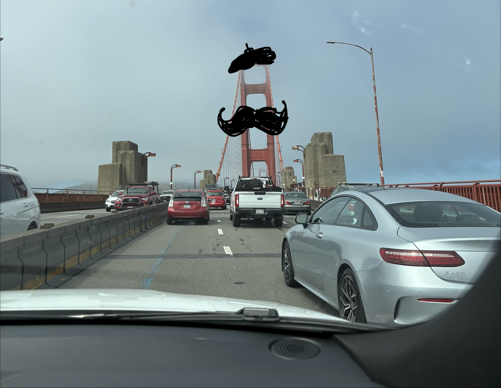

# Car Sick

*A doodled mustache on the Golden Gate Bridge — one of the absurd little games I play when I can no longer read in the car.*

Approximately 5 years ago, I started getting car sick, which was weird because I used to pride myself on being able to handle long, winding roads without ever needing a break. It happened to a few of my friends from boarding school as well – our theory was that the lack of cars in our lives made our bodies devolve to the point of no longer being tolerant of giant, swaying metal machines.

My newly acquired car sickness has forced me to adapt a few ways, namely:

1. To become the designated driver (I never get car sick when I drive)
2. To stop working, reading, or consuming content when I'm not the designated driver

The first one was easy. I loved driving; in particular, I love driving people I thought were cool and wanted to get to know better. I find that most people with decent manners find it rather awkward not to engage in meaningful conversation with me (the driver) when they are getting a lift. So, for rides to the airport, train stations, schools, banks, and more, I would have about an hour of uninterrupted time to learn from my passengers. Being in a car together is a more effective promoter of conversations than drinks or hobbies, since there's nothing better to do than talking. In my drives, I've learned about the cats from Turkey, the weird and shifting border dynamics of Vermont, the labor and anthropology behind textiles, and much more. When driving, I have no mental space to filter out my questions and my thoughts, which forces me to ask every stupid question that comes to mind, and in turn, those stupid questions lead to a better conversation, because as I've found, there's never a stupid question when you are engaging with someone who is talking about the subject of their life's work. Asking seemingly stupid questions is a trait I've learned to carry into my daily life outside of driving.

The second one, on the other hand, was painful for me. From ages 9-14, I was a professional short-track speed skater. This meant that every week, I would spend over 20 hours in cars and tour buses traveling to training camps and ice rinks. At the same time, I was a student at one of the most rigorous public schools in Hong Kong. This meant that every tour bus ride was accompanied by my sitting by the window, trying my best to keep my handwriting decent despite the constant bumps in the road. Over time, I've become accustomed to working while traveling – I had my routine ready to go: I would record material I should memorize for the ride beforehand, listen to it throughout the trip, and reserve my written work for the hour or so we are stuck in traffic in a tunnel with no internet access. Over time, I've essentially conditioned myself to do some of my best work on a bus or on a train, and so, even now, I feel the urge to start reading or writing whenever I have to travel for over 20 minutes on the train or the bus.

Unfortunately for me, that's no longer an option. After 5 minutes of looking at my phone, I start getting dizzy. If I persist for another 10, I start feeling this intense urge to vomit. I never vomit, but the feeling lasts for the remainder of the ride no matter what I do to try to ditch it. To some extent, I blame it on the insane speeds American highways allow (especially compared to Hong Kong). I also blame it on my friends being… questionable drivers (we are called M*ssholes for a reason).

But, as time goes on, I started to get used to it. I would sit and just enjoy the repetitive view I see every time I go into Boston. I would let my mind wander, imagining absurd things like hanging a giant cartoonish mustache on a school or creating entire societies for the raindrops on the windowsill. I started recognizing cars and their respective models, discovering patterns of different towns and what cars the people living there preferred. I read bus ads, license plate frames, and yard signs, learning about the dealerships and events going on in the neighborhoods around me. Sometimes, I would even peek into the cars of other people, imagining myself in their car and engaging in their conversation or lack thereof.

Suddenly, whenever I'm in a car, I revert back to my 4-year-old self. I am endlessly fascinated by the little Doraemon plushie/tissue paper holder that my dad put up for me, the hums and stalls of the engine, the seemingly illogical start-stop patterns of traffic (bottlenecks were mind-blowing to me as a kid), and the repetitive but sometimes informative radio shows. Maybe this car-sick thing isn't so bad after all, if it forces me to regain imagination and whimsy.
