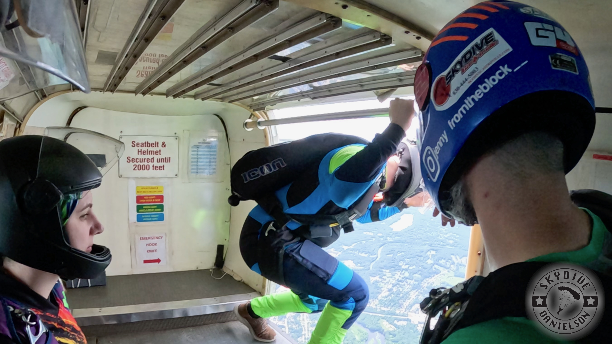
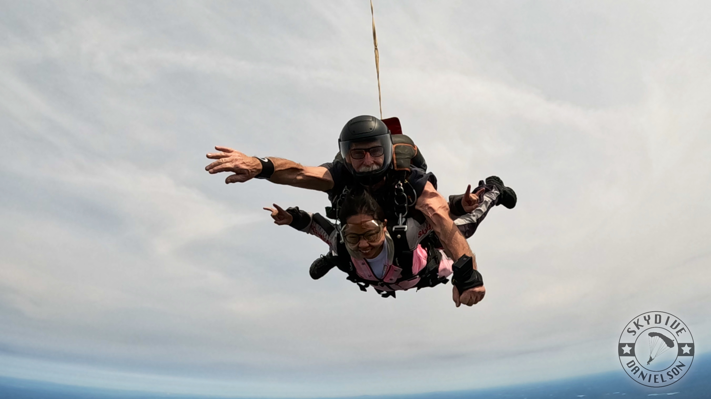

*The exact moment I realised I'll be jumping out of a plane during my first ever sky dive.*

As you fall out of the sky, you realise have two options: 

1) to land safely   
2) to die

There are very few things in life that feel that certain. In those seven minutes of free fall, there is only one thing to focus on. There is no ambiguity, no second-guessing, no “what should I be doing right now?” There is a primal instinct that kicks in during skydiving that forces you to just lock the fuck in.

That kind of clarity does not happen anywhere else in my life.

As someone in start-up and tech, most of my life is defined by uncertainty, and not the kind that resolves itself quickly. Every decision feels like it compounds over months or years. In a startup, you are always asking yourself what matters most, and the answer changes every week. There are always ten things that feel urgent, five that feel existential, and no clear instruction on which one actually determines whether you succeed or fail. It creates a kind of mental fragmentation where you are always partially somewhere else. Even when you are doing one thing, you are thinking about the other nine.

I did not realize how bad this had gotten until a night at Chili’s.

I was driving to Chili’s with my fraternity family (my big, Rocelin, and a few of my frat siblings). It was one of those rare nights where everyone was actually free. People are graduating soon, schedules don’t align, and even when we say we’ll hang out, something usually comes up. On the drive there, someone was in the back playing Brawl Stars, someone was watching a rug-cleaning ASMR video, and no one was really chatting in the car. Then Rocelin took away all of our phones.

She just said we were going to be present.

I had told her beforehand that I needed five minutes to hop on a work call, so she gave me my phone back since I was driving. I joined the call, but the entire time I felt split. I kept thinking, “I want to talk to them. I want to be there. These are people I care about, and they’re about to graduate.” At the same time, I was trying to follow what was happening on the call.

I felt like shit.

It wasn’t that the call was unimportant. It was that I had already decided to be somewhere else, and I was failing at both. I wasn’t fully on the call, and I wasn’t present with my friends. I was just stuck in between.

After those five minutes, I ended the call, put my phone away, and walked back in.

There was no transition period. No gradual shift. I just sat down, and that was it. My phone was gone. My laptop was gone. There was nothing else to do except talk.

And for the first time in a long time, we actually talked.

We shared personal stories, things I did not know, even though I had been close with these people for a year. These were stories that don’t come up in passing conversation, tales that deserve attention, time, and the absence of distraction.

The whole exchange was at a Chili’s in an outdoor mall that was mostly closed. Objectively, nothing about that setting is special. But somehow, it was the best social interaction we had had in a while.

We were single-minded. Everyone in that booth had decided, whether consciously or not, that this was the one thing we were doing. There was no second screen, no background task, no “just one more message.” We were just there.

I think about that night a lot, because it felt similar to skydiving in a way I did not expect.

Not because of the intensity, but because of the singularity.

*My tandem instructor and I free falling in my first ever skydive.*

In skydiving, you do not get to divide your attention. Your body forces you into one path. Once you understand what it feels like to have all of your focus aligned toward a single outcome, it is very hard to ignore how scattered everything else feels.

I started noticing it in smaller moments.

Recently, I deleted all of my social media. No LinkedIn, no Instagram, no YouTube. At one point, I got so desperate for stimulation that I started reading a promotional email in my work inbox.

But then something shifted.

One day, I sat down to eat lunch. It was simple: bread I got from an Amish community in Maine, three fresh eggs, and some butter. Normally, I would have been watching a YouTube mukbang, reading a book, waiting for code to run in the background, or all three at once. There would always be something else happening.

This time, I just ate.

The eggs were fresh. The yolk had that rich, almost creamy taste. The whites were plain, but soft and fluffy. The bread was slightly sweet, crumbly, and fresh. The butter melted just enough to hold everything together.

It was the most satisfying meal I had in a long time. For the first time in what felt like years, I finished a meal and did not feel like I needed more. I did not feel like I had been distracted through it. I did not feel like I had missed it. That moment made something very clear to me. It is not that I am doing too many things. It is that I am never fully doing any one thing.

Skydiving forces you to confront that. You cannot multitask your way through free fall. You cannot hedge your attention. Your brain simplifies everything into one directive: survive and land safely. Once you have felt that level of clarity, it becomes difficult to justify the way you live the rest of your life. You start to see how much of your time is spent in partial states. Half working, half resting. Half present, half elsewhere. Always thinking about the next thing while doing the current one.

There is a trade-off involved. You cannot have everything at once. You cannot be everywhere at once. The idea that you can is what creates the fragmentation in the first place. Skydiving makes that trade-off explicit. You choose to commit to one outcome, and everything else disappears.

In the same way that, in those seven minutes, you are not trying to do anything except land. 

You just lock in.
